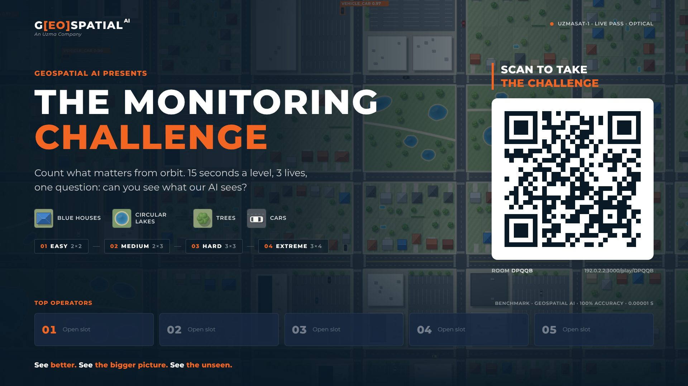
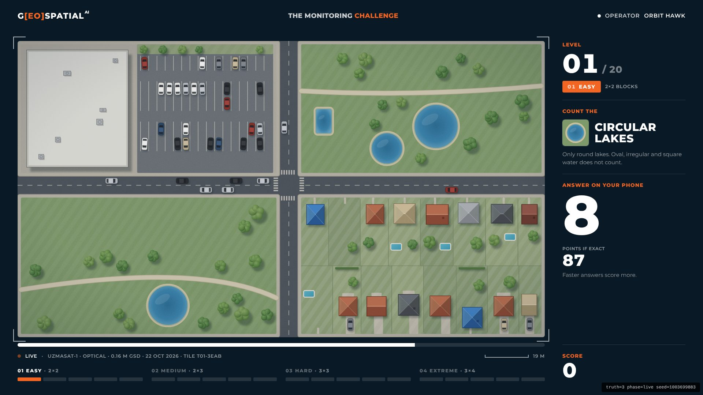
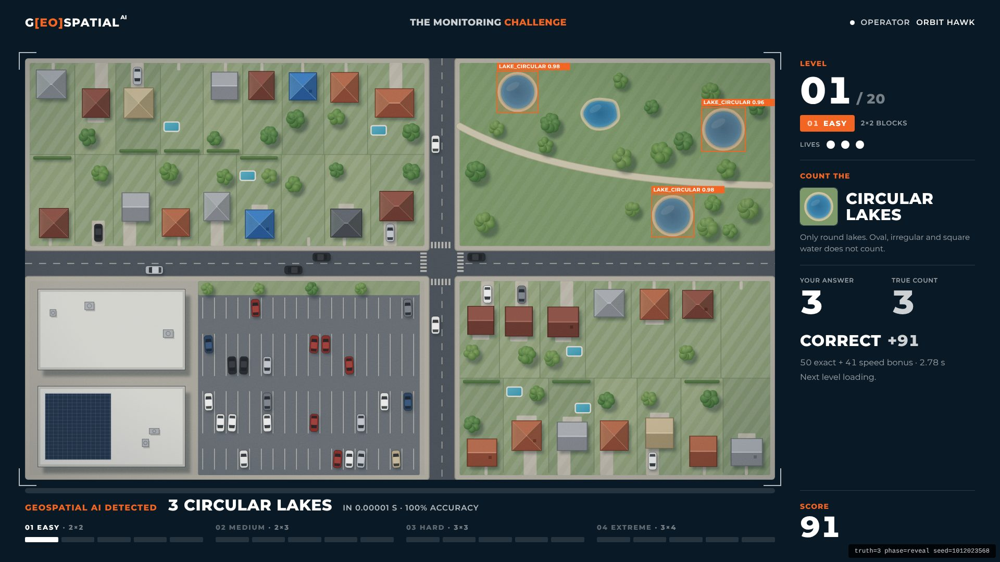
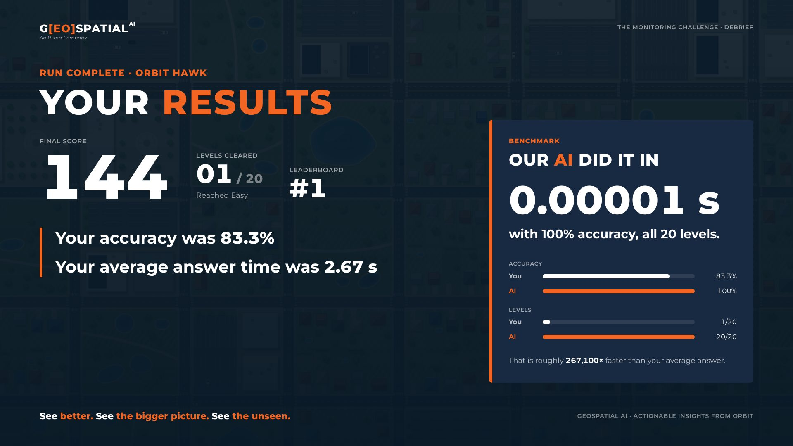
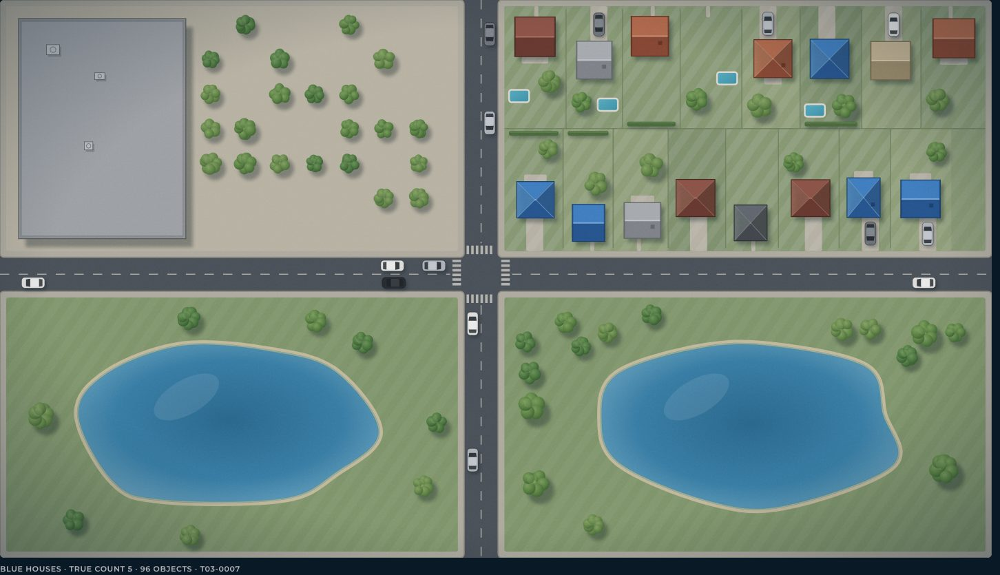
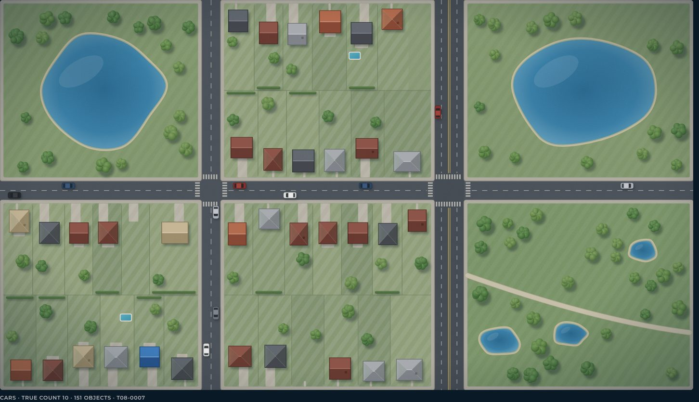
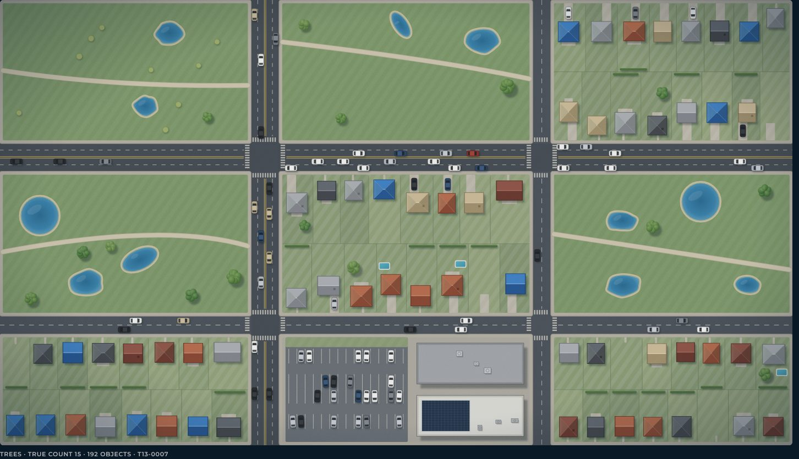
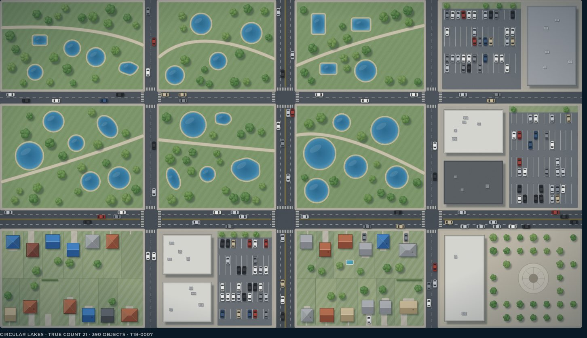
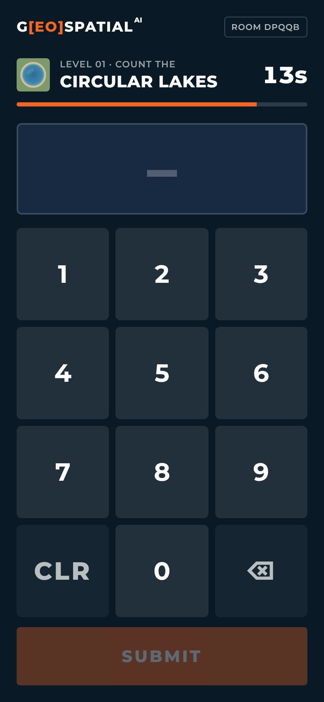

# The Monitoring Challenge

A booth game for **Geospatial AI** (An Uzma Company). A big screen shows a top-down satellite-style city. Players have **10 seconds** to count one kind of object (blue houses, circular lakes, trees or cars) and type the count on their phone while they look. The city grows over 20 levels in four tiers, from **2×2 to 3×4 city blocks**. An exact answer advances, and the first miss or timeout ends the run. Points reward accuracy and speed. The display plays synthesised music and sound effects. The end screen compares the player with our AI: **0.00001 s, 100% accuracy**.

This is a **local proof of concept**. It runs on one laptop plus phones on the same Wi-Fi, with no accounts or cloud services. Realtime messaging and the leaderboard sit behind small interfaces, so the next developer can plug in a hosted service and a database and deploy to Vercel. See [docs/HANDOFF.md](docs/HANDOFF.md).



| Live round (10 s) | AI reveal | Results |
|---|---|---|
|  |  |  |

| Easy 2×2 | Medium 2×3 | Hard 3×3 | Extreme 3×4 | Phone |
|---|---|---|---|---|
|  |  |  |  |  |

## Run it

Requires Node 20+.

```bash
npm install
npm run dev:lan        # Next.js on 0.0.0.0:3000 + realtime relay on :3001
```

1. On the laptop that drives the TV, open **http://localhost:3000** and go full screen (F11). The display shows a QR code that points at the laptop's LAN address.
2. Scan the QR code with a phone on the **same Wi-Fi**, enter a nickname and press START.

For the booth itself, run `npm run kiosk`. It makes a production build, then starts the server and relay.

**Venue Wi-Fi tip:** guest networks often block device-to-device traffic. Use the laptop's hotspot or a small travel router so phones can reach the laptop. If the QR code shows the wrong address, set `NEXT_PUBLIC_PUBLIC_URL=http://<laptop-ip>:3000` in `.env.local`.

### Phone can't connect? Checklist

1. Check the address under the QR code (for example `192.168.1.23:3000/play/ABCDE`). Type `http://` plus that address into the phone's browser.
   - **Page doesn't load at all:** the phone can't reach the laptop. The Wi-Fi probably isolates devices (common on office and guest networks). Use the laptop's hotspot or a travel router.
   - **The address looks wrong** (not your Wi-Fi address): set `NEXT_PUBLIC_PUBLIC_URL=http://<laptop-ip>:3000` in `.env.local` and restart. On a Mac, find the address under System Settings → Wi-Fi → Details, or run `ipconfig getifaddr en0`.
2. **Page loads but says "Linking to the big screen…":** the phone can't reach the relay on port 3001. Make sure the terminal shows the `relay` line, and that the macOS firewall allows incoming connections for `node`.
3. **For the booth, prefer `npm run kiosk`.** It runs a production build, which is faster on phones and doesn't have the dev server's origin checks.

### Test without a phone

Open `http://localhost:3000/?transport=broadcast`, then open the URL under the QR code in a second window of the same browser (it ends in `?transport=broadcast`). The two windows talk directly, so no relay is needed.

### Display options

| Query | Effect |
|---|---|
| `?debug=1` | Shows the true count in the corner and exposes state on `window.__MC__` |
| `?speed=0.25` | Runs every timer 4× faster |
| `?transport=broadcast` | Pairs with a phone window in the same browser |
| `?sound=0` | No music or sound effects |

On the display, press **Esc** to return to the attract screen and **M** to mute or unmute.

### Sound

Music and sound effects are synthesised live with the Web Audio API, so there are no audio files and they work offline. They play from the big screen only; phones stay silent apart from vibration.

Browsers block audio until someone interacts with the page, so:

- **Simplest:** at setup, click once anywhere on the display (or press any key). Sound then stays on for the day, unless the tab reloads. Until then, a small "enable sound" hint shows on the attract screen.
- **Unattended kiosk:** launch Chrome with autoplay allowed, and sound starts by itself:
  ```bash
  google-chrome --kiosk --autoplay-policy=no-user-gesture-required --user-data-dir=$HOME/.mc-kiosk http://localhost:3000
  ```
  On a Mac the binary is `"/Applications/Google Chrome.app/Contents/MacOS/Google Chrome"`. The flag is ignored if Chrome is already running with the same profile, which is why the command uses a dedicated `--user-data-dir`.

Tune or audition every cue and music mode at `/dev/audio`.

## How the game works

Every level is one **10-second live round**. The tile appears on the big screen while the phone keypad is open. Answering ends the round straight away, so a faster exact answer scores more. If the 10 seconds run out, it counts as a miss.

| Tier | Levels | City | Zoom (house / car on screen) | Objects | Points per level |
|---|---|---|---|---|---|
| Easy | 1–5 | 2×2 blocks | ~57 / 34 px | 2 → 7 | 100 |
| Medium | 6–10 | 2×3 blocks | ~46 / 27 px | 7 → 12 | 200 |
| Hard | 11–15 | 3×3 blocks | ~38 / 22 px | 12 → 17 | 350 |
| Extreme | 16–20 | 3×4 blocks | ~34 / 20 px | 17 → 24 | 500 |

- Difficulty comes from the city: each tier shows more blocks, zoomed out so everything is smaller. From Hard onwards, **look-alikes** appear: slate and teal roofs, oval lakes, round plazas and shrubs.
- **Points per level** = base × accuracy × (50% + 50% × speed). Accuracy is `1 − |answer − truth| / truth`. Speed runs from 1 for an instant answer to 0 at 10 s. An exact answer therefore earns between half and all of the base. The display shows the "points if exact" draining live.
- **Answer time** is measured on the phone, from the keypad opening (when the tile appears) to SUBMIT, so network lag never counts. The display bounds it by its own clock, so a reloaded phone or a forged message can't claim an instant answer.
- **Final accuracy** is the mean accuracy over all rounds played. The average answer time excludes timeouts.
- The leaderboard ranks by score, then faster average time. Scores are kept per display browser, under a `v2` storage key, so scores from the earlier timing don't mix in.

All of these numbers live in [`src/game/levels.ts`](src/game/levels.ts) and [`src/game/scoring.ts`](src/game/scoring.ts), so they can be tuned after playtesting.

## The city

Cities are procedural SVG, seeded so every level can be reproduced. The generator ([`src/city/generate.ts`](src/city/generate.ts)) is **slot based**:

1. Each block lays out non-overlapping places where a house, tree, lake or car could go.
2. Exactly `count` of the target's slots are filled.
3. Every other slot of that kind is either left empty or filled with a clearly different variant.

So the true count is guaranteed by construction, and unit tests check it across every level, target and many seeds.

The renderer ([`src/city/CityMap.tsx`](src/city/CityMap.tsx)) draws a restrained daylight map illustration:

- pitched hip and gable roofs with lit and shaded faces
- one consistent north-west sun, with cast shadows
- road markings and zebra crossings, and left-hand traffic
- lakes with shorelines, and lobed tree canopies
- sensor grain and a vignette

Preview any tile at `/dev/cities?level=12&target=car&seed=7&detections=1` (leave out `target` to see all four).

## Project layout

```
server/relay.ts            local WebSocket room relay (PoC only)
src/app/page.tsx           display (big screen)
src/app/play/[room]/       phone controller
src/app/api/lan-info/      LAN IP for the QR code
src/app/dev/cities/        tile preview gallery
src/game/                  levels, scoring, protocol, pure state machine (engine.ts)
src/city/                  generator, palette, SVG sprites and renderer
src/realtime/              Transport interface + ws / BroadcastChannel adapters
src/leaderboard/           LeaderboardRepository interface + localStorage store
src/components/display/    display screens and the game host hook
src/components/phone/      phone screens and keypad
src/audio/                 Web Audio engine, synthesised SFX and music, pure cue mapping, display hook
src/app/dev/audio/         audio lab: audition every cue and music mode
scripts/                   capture-screenshots.mjs (regenerates docs/screenshots)
docs/DESIGN.md             Geospatial AI design system the UI follows
docs/HANDOFF.md            how to connect a database / realtime service and deploy
```

## Checks

```bash
npm run typecheck
npm run lint
npm test               # Vitest: generator exact counts and overlaps, levels, scoring, state machine, audio cues
npm run e2e            # Playwright: full run, timeout run, busy room, offline audio renders and autoplay
```

To refresh the README screenshots, start the app (`npm run dev:lan`) and run `node scripts/capture-screenshots.mjs`.

`npm run e2e` starts its own dev server on port 3100. If Chromium is installed somewhere non-standard, set `CHROMIUM_PATH=/path/to/chrome`.
